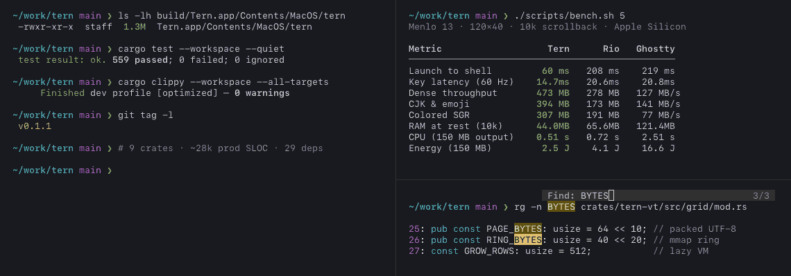

# Tern

**The fastest and most memory-efficient terminal emulator for macOS.**

Tern is a 1.3 MB native macOS terminal written from scratch in Rust (~28k production SLOC), built directly on AppKit, Core Text, and Metal with zero cross-platform UI, GPU, or VT-parser frameworks. Across eight macOS terminals benchmarked under identical conditions (`Tern`, `Rio`, `Alacritty`, `kitty`, `Ghostty`, `WezTerm`, `iTerm2`, and Apple `Terminal`), Tern places first on startup latency, key-to-screen latency, physical memory footprint, CPU and energy under load, all five 150 MB throughput workloads, and 8 of 10 `vtebench` microbenchmarks (tied within sub-millisecond noise on the other two):



| Metric | Tern | Best Competitor | Advantage |
| --- | ---: | ---: | --- |
| **Launch to shell** | **60 ms** | 188 ms (WezTerm) | **3.1x faster** |
| **Launch to visible window** | **187 ms** | 235 ms (Alacritty) | **1.26x faster** |
| **Key-to-screen latency (60 Hz)** | **14.7 ms** | 14.9 ms (Alacritty) | Single-frame hardware floor (`14.3 ms` mean) |
| **Throughput — plain source** | **288.6 MB/s** | 275.1 MB/s (Rio) | **+5%** (at macOS PTY ceiling) |
| **Throughput — dense / long lines** | **472.7 / 473.8 MB/s** | 278.1 / 301.7 MB/s (Rio) | **1.6x–1.7x faster** |
| **Throughput — CJK & emoji** | **394.1 MB/s** | 172.7 MB/s (Rio) | **2.3x faster** |
| **Throughput — SGR colored** | **307.0 MB/s** | 191.4 MB/s (Rio) | **1.6x faster** |
| **RAM at rest (after launch)** | **30.9 MB** | 33.8 MB (Rio) | Lowest footprint |
| **RAM at rest (10k-line history)** | **44.0 MB** | 57.4 MB (Terminal) | **13–77 MB lower** than Terminal / Rio / Ghostty |
| **CPU & energy (150 MB output)** | **0.51 s / 2.5 J** | 0.72 s / 4.1 J (Rio) | **29% less CPU, 39% less energy** |
| **App bundle size** | **1.3 MB** | ~22–62 MB | Zero-framework native binary |

## Quick Start

### Download (Apple Silicon, macOS 14+)

Download the signed, Apple-notarized DMG from the [latest GitHub Release](https://github.com/kaiwencui/tern/releases/latest) (`Tern-0.1.3-arm64.dmg`, 1.4 MB), open it, and drag **Tern.app** to **Applications**.

### Build from Source

Requires macOS 14+ and Rust 1.95+ with Xcode Command Line Tools.

```sh
./scripts/build-app.sh
open build/Tern.app
```

---

## Benchmarks

All eight terminals were measured in a single five-round alternating pass on an unlocked Mac mini (Apple M6, macOS 27.0, 1920x1080 @ 60 Hz) using `Menlo 13`, a `120x40` cell grid, and a `10,000`-line scrollback limit via `./scripts/bench.sh 5`.

`termbench` writes five 30 MB workloads (150 MB total) through the PTY and blocks on a `DSR` (`CSI 6 n`) cursor-position query after each payload so timing ends only when the terminal has parsed every preceding byte. Memory is physical footprint reported by `vmmap`. (Warp is omitted because it provides no CLI flag to execute a benchmark command at launch.)

### Output Throughput & Startup

Medians across 5 alternating rounds (MB/s higher is better; ms lower is better):

| Terminal | Source (MB/s) | Dense (MB/s) | CJK / Emoji (MB/s) | Colored (MB/s) | Long Lines (MB/s) | Shell (ms) | Window (ms) |
| --- | ---: | ---: | ---: | ---: | ---: | ---: | ---: |
| **Tern** | **288.6** | **472.7** | **394.1** | **307.0** | **473.8** | **60** | **187** |
| Rio 0.5.29 | 275.1 | 278.1 | 172.7 | 191.4 | 301.7 | 208 | 236 |
| Alacritty 0.17.0 | 150.6 | 161.2 | 153.6 | 174.3 | 195.8 | 216 | 235 |
| kitty 0.50.0 | 137.7 | 197.5 | 136.5 | 134.7 | 202.0 | 319 | 343 |
| Ghostty 1.3.1 | 100.5 | 126.6 | 141.2 | 76.8 | 127.8 | 219 | 283 |
| iTerm2 3.7.7 | 99.4 | 112.3 | 21.1 | 17.4 | 121.1 | 630 | 671 |
| WezTerm 20240203 | 51.6 | 54.7 | 24.0 | 66.8 | 51.4 | 188 | 254 |
| Terminal 2.15 | 42.4 | 51.4 | 40.2 | 24.0 | 52.3 | 652 | 337 |

On dense cells, CJK/emoji, colored SGR text, and long lines, Tern's slowest round beat every other terminal's fastest round. On plain source code, both Tern and Rio hit the initial macOS PTY ramp-up; past the first few megabytes Tern sustains ~405 MB/s (within a few percent of raw PTY `read()` discard speed) while continuing to render live Metal frames.

### Physical Memory Footprint (MB)

Sampled immediately after launch, 5 s later at rest, immediately after 150 MB of output, and 5 s later at rest with 10,000 lines retained in scrollback:

| Terminal | After Launch | Launch at Rest | After 150 MB | At Rest (10k History) |
| --- | ---: | ---: | ---: | ---: |
| **Tern** | **31.0** | **30.9** | **72.4** | **44.0** |
| Terminal 2.15 | 35.4 | 35.1 | 82.4 | 57.4 |
| Rio 0.5.29 | 33.8 | 33.8 | 95.8 | 65.6 |
| Alacritty 0.17.0 | 46.3 | 46.1 | 118.4 | 85.3 |
| WezTerm 20240203 | 49.1 | 49.0 | 135.7 | 112.5 |
| Ghostty 1.3.1 | 86.9 | 74.3 | 125.6 | 121.4 |
| kitty 0.50.0 | 99.7 | 95.6 | 163.7 | 147.3 |
| iTerm2 3.7.7 | 146.8 | 136.7 | 373.7 | 369.9 |

### CPU Time, Energy & Idle Efficiency

Kernel `rusage_info_v6` CPU time and package energy for the 150 MB workload, plus idle cost per second:

| Terminal | 150 MB CPU (s) | 150 MB Energy (J) | Idle, Cursor Hidden (ms/s) |
| --- | ---: | ---: | ---: |
| **Tern** | **0.51** | **2.5** | **0.12** (`0.03` over 20 s) |
| Rio 0.5.29 | 0.72 | 4.1 | 0.08 |
| Alacritty 0.17.0 | 1.07 | 6.4 | 0.04 |
| kitty 0.50.0 | 1.11 | 6.9 | 0.77 |
| Ghostty 1.3.1 | 2.51 | 16.6 | 6.70 |
| Terminal 2.15 | 3.65 | 20.2 | 0.33 |
| WezTerm 20240203 | 6.61 | 42.7 | 0.08 |
| iTerm2 3.7.7 | 7.95 | 43.1 | 13.80 |

Tern ships with a steady cursor by default (`cursor-style-blink = false`), keeping idle CPU at the `~0.03–0.12 ms/s` floor. Even with blinking enabled (`cursor-style-blink = true`), Tern toggles a lightweight Core Animation cover layer over empty cells instead of redrawing Metal frames (`~0.7 ms/s`, releasing ~20 MB of Metal driver surfaces when idle).

### Key-to-Screen Latency

End-to-end latency from synthetic `CGEvent` key press to `ScreenCaptureKit` frame presentation timestamp across `n = 200` randomized presses per terminal on a 60 Hz display (`16.7 ms` refresh period; `TERN_BENCH_KEYS=200 ./scripts/bench.sh 0`):

| Terminal | Median (ms) | Mean (ms) | p90 (ms) | p99 (ms) |
| --- | ---: | ---: | ---: | ---: |
| **Tern** | **14.7** | **14.3** | **18.2** | **19.7** |
| Alacritty 0.17.0 | 14.9 | 14.7 | 18.7 | 19.7 |
| kitty 0.50.0 | 15.3 | 15.3 | 19.8 | 24.5 |
| WezTerm 20240203 | 15.8 | 15.6 | 19.9 | 21.3 |
| iTerm2 3.7.7 | 18.1 | 17.3 | 22.9 | 26.1 |
| Rio 0.5.29 | 20.6 | 20.2 | 25.2 | 31.3 |
| Ghostty 1.3.1 | 20.8 | 20.3 | 25.7 | 29.8 |
| Terminal 2.15 | 22.1 | 21.5 | 25.6 | 31.7 |

Uniformly distributed key arrivals wait `8.3 ms` on average for vsync alone plus scanout, making `~14–15 ms` the physical single-frame floor at 60 Hz.

### `vtebench`

Mean milliseconds per sample (lower is better; `TERN_BENCH_VTEBENCH=<dir> ./scripts/bench.sh 5`):

| Benchmark | Tern | Rio | Alacritty | Ghostty | kitty | WezTerm | Terminal | iTerm2 |
| --- | ---: | ---: | ---: | ---: | ---: | ---: | ---: | ---: |
| `dense_cells` | 4.01 | **4.00** | 4.14 | 7.06 | 6.10 | 6.60 | 21.90 | 104.10 |
| `medium_cells` | **3.01** | 3.37 | 6.05 | 9.72 | 6.06 | 26.86 | 36.81 | 239.90 |
| `scrolling` | **7.90** | 8.01 | 12.65 | 16.50 | 67.29 | 49.96 | 128.85 | 17.66 |
| `scrolling_bottom_region` | **6.08** | 8.00 | 8.04 | 16.00 | 31.00 | 45.06 | 110.98 | 459.64 |
| `scrolling_bottom_small_region` | **6.05** | 8.00 | 8.05 | 15.96 | 32.10 | 44.95 | 110.98 | 459.55 |
| `scrolling_fullscreen` | 9.40 | **8.97** | 19.00 | 21.03 | 124.22 | 63.00 | 131.12 | 29.40 |
| `scrolling_top_region` | **12.43** | 26.50 | 21.16 | 16.07 | 23.48 | 62.77 | 111.96 | 2465.33 |
| `scrolling_top_small_region` | **6.07** | 7.05 | 8.02 | 15.98 | 31.35 | 45.10 | 110.70 | 458.45 |
| `sync_medium_cells` | **3.02** | 3.20 | 8.00 | 10.00 | 12.98 | 36.43 | 37.69 | 249.62 |
| `unicode` | **2.31** | 5.36 | 5.60 | 6.95 | 7.28 | 19.62 | 35.32 | 95.87 |

---

## Architecture

Tern is engineered around macOS kernel, CPU cache, and GPU constraints rather than cross-platform abstraction layers:

1. **Two-tier hybrid terminal storage (`crates/tern-vt`):**
   - **16-byte cell viewport (`Slab`):** Active screen rows live in a contiguous slab of 4-word (`16 B`) cells (`char` + 27-bit rare-extra handle, `fg`, `bg`, `Flags`). Rare combining marks, colored underlines, and `OSC 8` hyperlinks live in a segmented lock-free reference-counted table so 99.9% of cells never allocate. Scrolling rotates `u16` row indices in `O(1)`.
   - **Elastic `mmap` flood ring + 64 KB packed `Pages`:** During output floods, retired lines enter lazily `mmap`ped 512-row chunks (up to 40 MB) with zero compression work on the critical path; once full, the oldest ring slot is recycled in `O(1)`. `100 ms` after output goes idle, the background thread packs surviving history into `64 KB` pages of contiguous UTF-8 + run-length styles (~2 MB for 10,000 lines of 120-col code vs. ~19–24 MB of uncompressed cells) and `munmap`s the flood chunks back to macOS. Viewport rendering, selection, `Cmd+F` search, and streaming column reflow read packed pages directly in place without unpacking back into cells.

2. **Adaptive macOS PTY pipeline (`crates/tern-core`):**
   - macOS delivers PTY output in 1 KB chunks, blocking the child whenever the kernel buffer fills. Tern's reader thread sleeps directly inside `read()`, switches to spin-polling above `230 MB/s`, and continuously benchmarks kernel turnaround against parse cost—interpreting inline on the reader thread when parsing beats the child's next write (zero cross-thread handoff, overlapping child + terminal across two cores) and handing off to a dedicated parser thread with fair/unfair lock arbitration (`FairMutex`) when heavy escape sequences arrive.

3. **SIMD ground-state fast feeder & zero-buffering sync updates (`crates/tern-vt`):**
   - `feed.rs` bypasses byte-by-byte state transitions in ground state, expanding 16 ASCII bytes at a time via NEON vector stores, decoding UTF-8 runs inline, and applying common SGR/cursor/erase sequences directly to the row.
   - `parser.rs` handles arbitrary split UTF-8 sequences cleanly across read boundaries. Synchronized updates (`?2026`) are parsed immediately as bytes arrive while holding presentation on an `aside` snapshot, eliminating multi-megabyte redraw stalls.

4. **Direct Metal + Core Text renderer (`crates/tern-render`, `crates/tern-app`):**
   - One `CAMetalLayer` view draws all split panes in a window. Glyphs are rasterized once via Core Text into shelf-packed textures (keyed per `(size_pt, scale)` so windows zoom independently), box-drawing/braille/powerline sprites are synthesized pixel-exact on CPU, and only dirty rows rebuild instance ranges.
   - `CADisplayLink` pauses after `64 ms` of idle so interactive keystrokes render immediately on wakeup instead of waiting an extra display refresh cycle.

### Workspace Layout

| Crate | Prod SLOC | Responsibility |
| --- | ---: | --- |
| `tern-app` | ~9.1k | AppKit windows, native tabs, split-pane UX, Find bar, Services, session restore, JSON automation socket |
| `tern-vt` | ~8.1k | Custom VT parser, NEON fast feeder, 16B cell slab, `mmap` ring, 64 KB packed scrollback, streaming reflow, search |
| `tern-core` | ~3.6k | PTY management and adaptive 3-thread reader / parser / writer |
| `tern-layout` | ~1.9k | Pure binary split-pane tree, proportional resize math, drop zones |
| `tern-config` | ~1.6k | Zero-dependency config & Ghostty-compatible theme loader, keybindings |
| `tern-render` | ~1.5k | Core Text rasterizer, shelf packer, Metal pipeline & offscreen renderer |
| `tern-input` | ~0.8k | Legacy xterm & Kitty keyboard protocol, mouse reporting, bracketed paste |
| `tern-bench` | ~0.7k | `termbench` cross-terminal throughput, `rusage_info_v6`, and `vtebench` harness |
| `tern-types` | ~0.4k | Shared plain-data frame, cell, key, and theme types |

External dependency footprint: **29 crates total** (`objc2*` Apple bindings, `libc`, `parking_lot`, `memchr`, `unicode-width`, `bitflags`, `base64`).

---

## Features & Controls

- **Native Tabs & Split Panes:** `Cmd+T` new tab, `Cmd+Shift+T` show/hide tab bar, `Cmd+D` / `Cmd+Shift+D` split right/down, `Cmd+[` / `Cmd+]` or `Cmd+Opt+Arrow` focus, `Cmd+Ctrl+Arrow` resize, `Cmd+Shift+Enter` zoom, double-click tab (or right-click / **Window → Rename Tab…**) to rename.
- **Context Menus & Live Docking:** Right-click any pane (`Shift+right-click` inside mouse-aware TUIs) for link/file actions, copy/paste, split/zoom/find/clear, and right-click any tab for rename, new tab, move to new window, merge, or close others. `Cmd+Opt`-drag any pane across splits, tabs, or separate windows; drag a tab onto another window's titlebar or tab bar to merge as a tab, or onto a pane edge to dock its split tree.
- **Instant Scrollback Search & Indicator:** `Cmd+F` searches live screen and packed scrollback (`Enter` / `Cmd+G` next, `Shift+Enter` / `Cmd+Shift+G` previous, `Escape` close), with a translucent right-edge scrollback thumb whenever scrolled into history.
- **Shell Integration & Tab Activity:** `OSC 7` directory tracking, `OSC 133` prompt jumping (`Cmd+Up` / `Cmd+Down`) and command-output selection (`Cmd+Shift+A`), `OSC 9;4` progress rings and automatic running-command spinners / unread completion dots in native macOS tabs, plus `OSC 9` / `OSC 777` Notification Center alerts and Dock bounce.
- **Smart `Cmd`-Click:** Opens `OSC 8` hyperlinks, plain `http`/`https` URLs, and local compiler/grep/git paths (`src/lib.rs:42:9`, `path(17,3)`, `~/...`) via `open-command` (e.g. `zed {file}:{line}:{col}`) or macOS default handlers.
- **Per-Window Zoom, Services & Session Restore:** `Cmd++` / `Cmd+-` / `Cmd+0` independent window font sizing; `tern <dir>`, Dock drop, and Finder Services (*New Tern Window/Tab Here*); automatic window/tab/split/cwd persistence in `~/.local/state/tern/session`.

### Configuration

`Cmd+,` opens `~/.config/tern/config` (creating a documented template on first use) and `Cmd+Shift+,` live-reloads open windows:

```ini
font-family = Berkeley Mono
font-size = 14
theme = Catppuccin Mocha
window-padding-x = 16
option-as-alt = left
open-command = zed {file}:{line}:{col}
keybind = cmd+shift+enter=toggle_zoom
```

Ghostty theme names work out of the box when Ghostty is installed or placed in `~/.config/tern/themes/`.

### Deliberate Non-Goals

- macOS 14+ only (no cross-platform windowing or GPU abstraction layer).
- No programming font ligatures and no inline terminal image protocols (Sixel / Kitty graphics).
- Programs may write to the clipboard (`OSC 52`) but cannot read it.

---

## Verification & Development

```sh
cargo test --workspace                            # 559 unit, property & digest tests (headless)
TERN_TEST_WAY=awake-own cargo test -p tern-core   # force specific PTY reader scheduling mode
cargo test -p tern-app -- --include-ignored --test-threads=1   # live AppKit/Metal socket tests
cargo clippy --workspace --all-targets
./scripts/build-app.sh                            # LTO release build -> build/Tern.app
./scripts/build-app.sh --next fast                # Preview build -> build/Tern Next.app
./scripts/notarize.sh                             # Developer ID sign, notarize & staple dist/Tern.zip
./scripts/notarize.sh dmg                         # Developer ID sign, notarize & staple a DMG in dist/
./scripts/notarize.sh --next dmg                  # Developer ID sign, notarize & staple Tern Next DMG in dist/
./scripts/bench.sh 5                              # reproducible multi-terminal benchmark suite
```

Tern Next is the preview app with an amber Dock icon. It has its own macOS bundle ID and
saves its windows and panes in `~/.local/state/tern-next/session` (or
`$XDG_STATE_HOME/tern-next/session`).
Build Next from `main` to try changes before tagging a stable release.

Set `TERN_SIGNING_IDENTITY` to the Developer ID Application identity in your
Mac's keychain so macOS can remember permissions across builds of each app.
To notarize a release, also set `TERN_NOTARY_PROFILE` to a profile saved with
`xcrun notarytool store-credentials`.

## License

[MIT](LICENSE)
